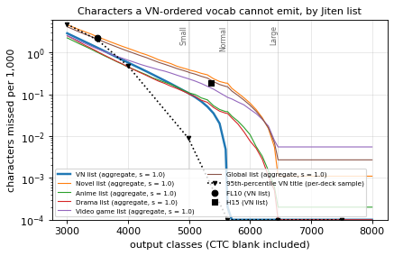
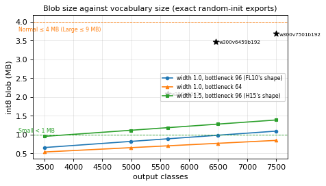

# Is the vocabulary too small? A missing-kanji analysis and a per-tier vocab decision

The owner (2026-10-14 06:18Z) worried that 5,354 characters (H15; FL10 has 3,500) is too small for VN
dialogue, and asked for a deep analysis against [Jiten's frequency dictionaries](https://jiten.moe/frequency-dictionaries)
and our own OCR data, then a decision. This document extends `docs/synth4-gap.md` section 1: it measures
coverage from occurrence-weighted word lists (not the single Zipf estimate of the gap analysis), measures
what the labelling pipelines hid, measures what a bigger head costs on the console under the owner's
three tiers, proves on a trained model that a bigger VN-ordered head costs no accuracy and reads the extra
characters, and recommends a vocabulary per tier with the exact files and a render plan for `vocr4-train`.

Every number is produced by `train/vocab_expand.py` (and the proof by `eval/vocab_proof_*.sh`); the result
files are under `$HERD/shared/artifacts/vocab-expand/` and the reproduce block is at the end. Console speed
is an **estimate** from the cycle model (`docs/vita-memory-budget.md`); nothing here ran on a console.

## Answers first

- **FL10 (3,500) is too small for VN text; H15 (5,354) is close to enough; a VN-ordered head is better than
  either at its size.** On Jiten's visual-novel word list, occurrence-weighted, FL10 cannot emit **2.28 of
  every 1,000 VN characters** (7.3 per 1,000 kanji), H15 **0.18** (0.58 per 1,000 kanji). FL10's miss is
  **8.7 of every 1,000 dialogue lines** (modelled), 27.8 at the 95th-percentile VN title; H15's is 1.8 / 1.0.
  A VN-ordered 4,987-class vocab misses 1.1 per 1,000 lines, a 5,631-class one essentially 0.
- **Our real labels hid the gap.** Every labelling pipeline drops a line with any character outside H15's
  vocab, so the kept labels show almost no OOV. On the lines they did **not** keep, both OCR engines agree on
  a character FL10 cannot emit in 5.2-5.5 of every 1,000 lines (296-393 VNs); for H15 that is 0.2 (9-12 VNs).
  The teacher's and realdata's raw accepted labels hold 47 and 41 FL10-OOV lines against 2 each for H15.
- **A bigger head is cheap and compute-light.** Exact int8 exports: a 4,987-class VN head at FL10's width is
  820 KB and an estimated 0.32-0.61 s per 3-line box at 444 MHz — the **Small** tier (< 1 MB, ≤ 1 s/box). A
  5,631-class head at width 2.5 is 2.10 MB / 0.96-1.83 s (**Normal**, ≤ 4 MB, ≤ 2 s). A 6,459-class head at
  width 3.0 is 3.48 MB / 1.45-2.79 s with 16-frame tiles (**Large**, ≤ 9 MB, ≤ 3 s). The head is the cheapest
  place to spend bytes: growing the vocab is parameter-heavy and compute-light, as the owner asked for.
- **The extra classes are learnable and cost no accuracy.** A pre-registered proof trained FL10's topology
  with a 4,987-class VN-ordered head against FL10's 3,500, two seeds, synth4's 16k-step recipe: on
  teacher_val **−0.195 points of CER** (VN-cluster 95% CI [−0.40, +0.01], not worse), on devnative v3 pooled
  **−0.313** (CI [−0.60, −0.04], better on native console). FL10 reads 0% of the added-class characters; the
  bigger head reads them, and its recall on the shared vocabulary is unchanged.
- **Recommendation.** Adopt a VN-ordered vocab per tier, in the next model round (a vocab change needs a new
  head): **Small `data/vocab_vn_4987.txt`** (4,987 classes), **Normal `data/vocab_vn_5631.txt`** (5,631),
  **Large `data/vocab_vn_6459.txt`** (6,459). The files nest, so one render of the Large vocab serves all
  three. The already-trained **`data/vocab_4987_proof.txt`** is an immediate drop-in for Small if `vocr4-train`
  wants the proven head now. Section 6 has the render plan and the hand-off.

## Data and method

**Sources (owner 10:00-10:02Z).** Jiten publishes a word list per media type and a kanji list, all CC BY-SA
4.0 (recorded in `data/jiten_fetch.py`'s manifest; the CSVs are local, never committed). The lists carry
*ranks*, not counts: Jiten ranks a word by `log(1 + occurrences) × (titles that use it)` and a kanji by the
same over all titles' raw text (`Jiten.Core/JitenHelper.cs`, `ApplyAggregatesAndRank` and
`ComputeKanjiFrequencies`, at Sirush/Jiten `7eac4d4`). A list therefore gives a character frequency only
through a model: **a word of rank r weighs r⁻ˢ and so does each character of its dictionary form** (the
`docs/synth4-gap.md` method), with s fitted so the kanji distribution the VN list implies is closest (KL) to
the kanji of our real training-side labels (69,429 lines over four pools, 237,419 kanji): **s = 1.0** (KL
0.164; the curve is flat from 0.9 to 1.05). Rates are **per 1,000 characters of the expanded word forms**
(dictionary spellings, no punctuation), the basis the lists support directly.

- Lists used: Visual Novel (2,162 scripts, the VN weighting and the kanji order), Novel + Web Novel, Anime +
  Drama + Movie, Video Game, Global (cross-checks), and the Kanji list (the primary kanji source, below).
- This is a different basis from `docs/synth4-gap.md`'s **2.90** per 1,000 for FL10: that was a single Zipf
  model with s = 0.95 over the whole word list including punctuation and names; this is the occurrence-weighted
  word list at s = 1.0 over content characters. Both agree FL10 misses a few per 1,000 and H15 a fraction of
  one; this document's **2.28** is the figure to cite.

**Emittable.** A reference character is emittable when every character of its `eval/metrics.norm()` (NFKC,
folded dashes, tildes and ellipses — the scoring rule) is produced by some class's `norm()`. So an ASCII `P`
class emits full-width `Ｐ`, and the full-width capitals `docs/synth4-gap.md` flagged for FL10 (Ｐ Ｖ Ｅ Ｌ Ｕ)
cost nothing on the score because the label convention (`realdata/vote.canon`) writes them as ASCII; FL10's
real miss on the VN list is kanji. (Measured without the folding, FL10 misses 2.47 per 1,000 and H15 0.18;
the folded figures above are the ones that match the CER metric.)

**Reserved titles.** Every statistic that steers the order or a curve excludes the titles of a reserved VN
(eval's test games, `is_test_vn`, every synth3 exclusion manifest including CLANNAD and the owner's test
titles, the development VNs). 426 of the 2,162 VN decks link to a reserved VN; the per-VN sample reports them
separately, and the sample's order influence is nil (the order comes from the aggregate list). CLANNAD,
vita-test, psp-test and devnative are read for their OOV rate only — character counts, nothing selected,
nothing sent to Codex.

## 1. Coverage of VN running text

The VN-ordered vocab is `data/vocab.txt`'s 486 non-kanji classes (kana, punctuation, ASCII and full-width
Latin and digits — each already rendered), then the kanji by VN-list weight. Per 1,000 characters of each
list (`vocab_expand.py tables agg.json`; `agg/agg.json`):

| vocab | classes | VN | Novel | Anime | Drama | Video game | Global | VN kanji |
|---|---|---|---|---|---|---|---|---|
| FL10 | 3,501 | 2.281 | 3.135 | 1.334 | 1.257 | 1.799 | 2.628 | 7.306 |
| H15 | 5,355 | 0.182 | 0.523 | 0.113 | 0.099 | 0.238 | 0.375 | 0.584 |
| proof (Small, trained) | 4,987 | 0.187 | 0.605 | 0.130 | 0.116 | 0.272 | 0.442 | 0.600 |
| VN-ordered 3,501 | 3,501 | 1.286 | 2.340 | 0.997 | 1.040 | 1.203 | 2.045 | 4.118 |
| VN-ordered 4,000 | 4,000 | 0.570 | 1.249 | 0.447 | 0.447 | 0.650 | 1.068 | 1.827 |
| **VN-ordered 4,987** | **4,987** | **0.107** | 0.389 | 0.111 | 0.104 | 0.235 | 0.339 | **0.342** |
| **VN-ordered 5,631** | **5,631** | **0.000** | 0.184 | 0.038 | 0.035 | 0.084 | 0.151 | **0.001** |
| **VN-ordered 6,459** | **6,459** | **0.000** | 0.106 | 0.022 | 0.019 | 0.064 | 0.093 | **0.000** |
| VN-ordered 7,501 | 7,501 | 0.000 | 0.018 | 0.002 | 0.002 | 0.019 | 0.018 | 0.000 |



- A VN-ordered head is better than FL10 or H15 at its own size: at 3,501 classes it misses 1.29 per 1,000
  against FL10's 2.28 (FL10 spends classes on characters VN text rarely uses). At 4,987 it misses 0.11,
  twenty times less than FL10 and below H15. At 5,631 the VN list is fully covered; 6,459 covers it with a
  margin and reaches into the other media (Novel 0.11 per 1,000).
- H15's own vocab is close to right for VN text, but **poorly ordered**: it holds 335 kanji the VN list never
  uses while a VN-ordered 4,987-class head already beats it. This is the gap analysis's point, now measured on
  occurrences rather than a Zipf fit.
- Beyond ~6,500 the gain is other-media text (Novel, Video Game); VN text is already fully covered, so a
  Large VN head stops where the Japanese-context kanji of the Kanji list run out (section 4).

**The Kanji list as a cross-check (owner 10:02Z).** Ordering the kanji by the Kanji CSV instead of the VN
counts covers VN kanji slightly worse at every size (e.g. 3,500 kanji: 2.18 per 1,000 missed against the VN
order's 1.86), and the two orders agree on 92-96% of their top N; the Spearman rank correlation of the VN
weight and the Kanji CSV rank over the 5,143 shared kanji is 0.98. So the two sources agree, and where they
differ the VN order wins for VN coverage, as instructed. The VN order's one kanji the Kanji CSV lacks is the
iteration mark 々; the Kanji CSV's VN-low entries are JIS X 0213 forms and, lower down, Chinese-only
characters from the all-media corpus (section 4 keeps those last).

**The 95th-percentile title.** Rare kanji cluster in names and specific titles, so the mean understates the
worst case. On the per-deck sample (below) each VN title's own rate: FL10 misses a median 0.84, a 95th-pct
3.40 and a worst 8.80 per 1,000; H15 0.006 / 0.117 / 3.07; the VN-ordered 4,987 head 0.000 / 0.009 / 0.37;
5,631 and above essentially 0 at every percentile. The worst FL10 titles are name-heavy (真・恋姫†英雄譚,
鬼哭街); H15's worst is a single title (夏空あすてりずむ) with unusual kanji.

### The per-VN tail: the per-deck sample (a sample)

Jiten also serves each title's own word-occurrence CSV. Before the owner stopped the per-deck fetch
(10:00Z), `data/jiten_fetch.py` had fetched **all 2,162 VN decks** (plus 92 Novel decks, unused). That full
VN set is used **only** for the per-VN tail above and the reserved-title check below — it enters no curve and
no ordering, which come from the aggregate list. It is a sample in the sense that the per-title numbers are
on a word-form basis (each form's characters times its occurrences), slightly different from the aggregate
list's rank model; the two agree to the last digit on the corpus rate. (`tail.json`, `vocab_expand.py tail`.)

A check: of the kanji each tier vocab adds, how many have 80%+ of their *sample* occurrences in reserved
titles (so the order could in principle lean on reserved text)? 53 for the 4,987 head, 138 for 5,631, 140 for
6,459 — but **none of them appears in any protected or development set** (vita-test, psp-test, CLANNAD refs,
devnative: 0 reference characters each), so the reserved titles do not drive any class that a protected score
would read. The order is built from design titles' aggregate weight regardless.

## 2. Selection bias: what the labelling pipelines hid

Our real labels cannot show characters beyond H15, because every pipeline drops a line with any out-of-vocab
character after review (`realplus/pool.py` and `native.py`, `teacher/build.py`, `realdata/build.py`, all test
`set(label) - vocab`). So the kept labels look clean (`vocab_expand.py bias`; `agg/bias.json`):

| source | kept lines | VNs | H15 cannot emit: lines / VNs | FL10 cannot emit: lines / VNs |
|---|---|---|---|---|
| realplus v2 | 50,823 | 9,336 | 13 / 10 | 310 / 268 |
| realplus v3 | 66,183 | 9,907 | 17 / 14 | 430 / 376 |
| native-frames pool | 1,924 | 225 | 3 / 3 | 13 / 13 |
| owner pool | 707 | 3 | 0 / 0 | 13 / 2 |
| teacher (raw accepted) | 10,049 | 1,241 | 2 / 2 | 47 / 43 |
| realdata (raw accepted) | 7,109 | 1,199 | 2 / 2 | 41 / 37 |

The hidden gap shows on the lines the pipelines did **not** keep. On realplus's raw engine reads, the share
of lines where **both** engine families (MeikiOCR and PP-OCRv6 small) read the same character a vocab cannot
emit:

| | lines never kept | FL10: both engines agree OOV | H15 | VN 4,987 | VN 5,631 |
|---|---|---|---|---|---|
| realplus v2 | 82,973 | 5.53 per 1,000 (459 lines, 393 VNs) | 0.21 (17, 12) | 0.13 (11, 7) | 0.11 (9, 5) |
| realplus v3 | 70,178 | 5.16 per 1,000 (349 lines, 296 VNs) | 0.21 (14, 9) | 0.16 (11, 7) | 0.13 (9, 5) |

So FL10's vocab, not only the drop filter, hides a real character in about 1 of every 200 training-side VN
lines; H15 and the VN-ordered heads lose a fraction of that. The teacher's and realdata's raw accepted labels
(their own voting rule, before the vocab filter) tell the same story: 47 and 41 FL10-OOV lines, 2 each for
H15, 0-1 for the VN-ordered heads.

**Protected and development sets (OOV rate only, nothing selected):**

| set | lines | H15: /1,000 lines, /1,000 chars | FL10: /1,000 lines, /1,000 chars | VN 4,987 | VN 5,631 |
|---|---|---|---|---|---|
| vita-test | 206 | 4.85, 0.39 | 14.56, 1.17 | 0, 0 | 0, 0 |
| psp-test | 245 | 0, 0 | 4.08, 0.40 | 0, 0 | 0, 0 |
| CLANNAD refs | 3,048 | 0, 0 | 1.64, 0.14 | 0, 0 | 0, 0 |
| devnative (kept) | 657 | 0, 0 | 1.52, 0.13 | 0, 0 | 0, 0 |

## 3. User impact: per 1,000 dialogue lines

Per 1,000 dialogue lines, how many contain at least one character the model cannot emit. The model treats
each content character of a line as an independent draw at the vocab's per-character miss rate, over the
content-length distribution of real VN dialogue lines (66,225 realplus v3 kept labels, p10/50/90 = 2/7/23,
mean 9.9). The independence model matches the directly measured per-line rate on vita-test, psp-test and
CLANNAD to the third digit (`lines.json` calibration), so it is a sound way to turn a per-character rate into
a per-line one. (`vocab_expand.py lines`.)

| tier / vocab | classes | aggregate model | sample median title | sample p95 title |
|---|---|---|---|---|
| FL10 | 3,501 | 22.2 | 7.2 | 27.8 |
| H15 | 5,355 | 1.8 | 0.05 | 1.0 |
| Small (proof 4,987) | 4,987 | 1.9 | 0.05 | 1.0 |
| **Small next (VN 4,987)** | 4,987 | **1.1** | 0.00 | 0.08 |
| **Normal (VN 5,631)** | 5,631 | **0.002** | 0.00 | 0.00 |
| **Large (VN 6,459)** | 6,459 | **0.000** | 0.00 | 0.00 |

(The aggregate per-line rates are higher than the sample's because the aggregate list's expanded word forms
are rare-kanji-dense dictionary spellings; the sample, on real title text, is the more representative view of
what a reader meets, and the owner's "per 1,000 lines" is the sample column. Both rank the vocabs the same.)
FL10 drops a character in roughly **1 of every 45-140 dialogue lines**; H15 and the trainable proof vocab
about 1 in 1,000 (worse at the 95th-pct title); a VN-ordered 5,631-class head essentially never.

## 4. Cost of expansion

Exact int8 blobs of `train/model.py` with random weights, exported by `train/export.py`, measured against
`vita/budget_sweep.py`'s Cortex-A9 cycle model (`docs/vita-memory-budget.md`). The owner's three tiers
(06:33-07:33Z): **Small** int8 weights < 1 MB, ≤ 1 s per 3-line 640-px textbox at 444 MHz; **Normal** ≤ 4 MB,
≤ 2 s; **Large** ≤ 9 MB, ≤ 3 s; the arena and line buffers sit on top, and the runtime picks the largest tier
that fits the free game memory. Head options at FL10's and H15's widths (`vocab_expand.py blobs`; the
model-tiers study `#74` covers widths 2.0-3.0; `budget/tier_rows.json`):

| config | classes | int8 blob | W8I arena | MACs/frame | est. ms/640-px line 333 / 444 | 3-line box @444 | tier |
|---|---|---|---|---|---|---|---|
| FL10 (today's Small) | 3,501 | 657,664 | 124,832 | 824,736 | 124-235 / 93-177 | 0.28-0.53 s | Small |
| w1.0 b96 **4,987** | 4,987 | **819,792** | 124,832 | 967,392 | 144-271 / 108-204 | **0.32-0.61 s** | **Small** |
| w1.0 b96 5,630 | 5,630 | 889,792 | 124,832 | 1,029,120 | 153-287 / 114-215 | 0.34-0.65 s | Small |
| w1.0 b96 6,500 | 6,500 | 984,832 | 124,832 | 1,112,640 | 164-308 / 123-231 | 0.37-0.69 s | Small |
| w1.0 b64 7,500 | 7,500 | 847,424 | 122,400 | 962,496 | 152-301 / 114-226 | 0.34-0.68 s | Small |
| w1.0 b96 7,500 | 7,500 | 1,093,824 | 124,832 | 1,208,640 | 177-332 / 133-249 | 0.40-0.75 s | Normal |
| H15 | 5,355 | 1,155,968 | 182,944 | 1,564,992 | 219-398 / 165-299 | 0.49-0.90 s | Normal |
| w1.5 b96 4,987 | 4,987 | 1,116,080 | 182,944 | 1,529,664 | 214-389 / 161-292 | 0.48-0.88 s | Normal |
| w1.5 b96 5,630 | 5,630 | 1,185,856 | 182,944 | 1,591,392 | 223-405 / 167-304 | 0.50-0.91 s | Normal |



The model-tiers study's proposed shapes, with the recommended vocab, measured here at both tilings:

| candidate | classes | int8 blob | W8I arena (t4 / t16) | 3-line box @444, t4 / t16 | tier |
|---|---|---|---|---|---|
| s_w100v4987 (Small) | 4,987 | 819,792 | 124,832 | 0.32-0.61 s | Small |
| n_w250v5631 (Normal) | 5,631 | 2,095,712 | 299,168 / 960,896 | 0.96-1.83 / 0.96-1.83 s | Normal |
| l_w300v6459b192 (Large) | 6,459 | 3,476,624 | 364,576 / 1,176,832 | 1.45-3.27 / **1.45-2.79** s | Large |

- **The head is parameter-heavy and compute-light.** Each added class costs about 109 blob bytes and leaves
  the arena unchanged; the kernels have no data-dependent branches, so time follows MACs, and the head is a
  third of them. A 4,987-class VN head is a Small model with room (820 KB of < 1 MB, 0.32-0.61 s of ≤ 1 s). A
  6,459-class head at width 3.0, the Large candidate, needs 16-frame tiles to meet ≤ 3 s (2.79 s against 4.18
  s at the default tiling, for 0.8 MB more arena); it is compute-bound at the default tiling, so the Large
  recommendation ships the 16-frame tiling.
- **Factorised-head bottleneck.** The head factorises through a bottleneck (`train/model.py`); shrinking it
  from 96 to 64 saves 181 KB at width 1.5 and keeps even a 7,500-class head in the Small tier (847 KB).
  Accuracy risk: `docs/arch-sweep.md` measured bottleneck 48 at width 1.0 at +0.26 points of CER with real
  data (CI −0.40 to +0.92), not significantly worse, so bottleneck 64 is a safe way to buy vocab bytes in the
  Small tier if a width-1.0 head needs more than 6,500 classes under 1 MB. The tier recommendations keep
  bottleneck 96 because they already fit.

## 5. Can the rare classes be learned? A pre-registered proof

Each added class needs enough rendered examples. synth4's curriculum already delivers them: it renders every
vocab class at least K = 80 times (VN) or 25 (other) per 1,000,000 crops, lifting the median class from 65 to
102 exposures and the count under 10 exposures from 1,167 to 29 (`docs/synth4.md`). So a vocab change needs
**no extra render budget**: it needs the renderer's `--vocab` extended to the new classes, the curriculum
rebuilt so the new classes get their K, nvsynth re-filtered to the new vocab, and a new head trained — a new
model round, not new data collection.

To show the extra classes are both learnable and free of cost, a protocol (`eval/vocab_proof_protocol.json`,
committed and pushed before any training) trained FL10's exact topology (width 1.0, bottleneck 96) with a
4,987-class VN-ordered head (`data/vocab_4987_proof.txt`) against FL10's 3,500-class vocab, two seeds, on
synth4's 16,000-step recipe (NVIDIA + synth4), scored through the C W8I runtime on the development cohorts.
The proof vocab is a subset of `data/vocab.txt`, so every class already has synthetic and NVIDIA renders.

| cohort | FL10 (F_s4) | 4,987 (G_v4987) | G − F, points (VN-cluster 95% CI) |
|---|---|---|---|
| teacher_val (decides) | 5.56% | 5.36% | **−0.195 ([−0.40, +0.01])** — not worse |
| devnative v3 pooled (guard) | 6.53% | 6.22% | **−0.313 ([−0.60, −0.04])** — better on native console |

- **No accuracy cost.** The bigger head is level on teacher_val (interval touches 0) and better on native
  console text; expanding the vocabulary at FL10's size does not hurt the shared classes.
- **The added characters are read.** Character-level recall by group (`eval/vocab_proof_strata_20261014.json`):
  on the development lines holding a character outside FL10's vocab, FL10 recalls **0%** (it emits `<unk>` or a
  lookalike), the 4,987 head **0.75-1.0**; the shared-vocab recall is unchanged (0.948 vs 0.947).
- **Learnability by exposure.** A synthetic probe (synth4's held-out calibration render, 15,000 crops,
  `eval/vocab_proof_probe_20261014.json`) reads the added classes at **55-57%** overall against FL10's 0%,
  with shared recall unchanged and overall CER slightly lower (0.100 vs 0.110). By the class's exposures in
  synth4's render: 50-100 exposures → 0.54, 100-300 → 0.63, under 50 → 0.05-0.13. So a rare class needs
  roughly **K ≥ 50-80 exposures** to be read reliably, which synth4's curriculum already targets; 814-847 of
  the 1,158 probed added classes are read at all.

The proof is FL10-width, 16k steps, two seeds, synthetic + NVIDIA only (no real fine-tune), so it bounds the
cost at the always-safe tier; the release recipe and the wider tiers are `vocr4-train`'s to measure. It shows
the direction clearly: a VN-ordered head of ~4,987 classes is a strict improvement over FL10's vocab at the
same size.

## 6. Recommendation per tier, and the hand-off to vocr4-train

Adopt a VN-ordered vocab per tier **in the next model round** (a vocab change needs a new head; it cannot be
retrofitted to a released model). The files are committed, nest (`vocab_vn_4987 ⊂ vocab_vn_5631 ⊂
vocab_vn_6459`, and the proof vocab ⊂ `vocab_vn_5631`), and share `data/vocab.txt`'s 486 non-kanji classes
(kana, VN punctuation, ASCII and full-width Latin and digits):

| tier | file | classes | VN miss /1,000 chars (lines) | new kanji vs vocab.txt | int8 blob | box @444 | adopt |
|---|---|---|---|---|---|---|---|
| **Small** (now) | `data/vocab_4987_proof.txt` | 4,987 | 0.19 (1.9) | 0 (subset of H15) | 820 KB | 0.32-0.61 s | now — trained and proven |
| **Small** (next) | `data/vocab_vn_4987.txt` | 4,987 | 0.11 (1.1) | 240 | 820 KB | 0.32-0.61 s | next round (needs a render) |
| **Normal** | `data/vocab_vn_5631.txt` | 5,631 | 0.000 (0.002) | 610 | 2.10 MB (w2.5) | 0.96-1.83 s | next round |
| **Large** | `data/vocab_vn_6459.txt` | 6,459 | 0.000 (0.000) | 1,214 | 3.48 MB (w3.0, t16) | 1.45-2.79 s | next round |

Why these sizes: 4,987 is the knee of the VN curve (twenty times fewer misses than FL10, below H15, no
accuracy cost proven) and fits Small with room; 5,631 covers the VN list completely; 6,459 is where the
Kanji list's **Japanese-context** kanji run out (every kanji in a Jiten global-list word or a VNDB character
name, in JIS X 0213) — beyond it the list ranks Chinese-only characters from Chinese text in a few titles,
which VN OCR does not need (the real labels use exactly 1 character beyond this limit). The order puts the
VN-list kanji first, then the Japanese-context Kanji-CSV kanji by rank, then the rest; the Large file stops
before the non-Japanese tail. All three are nested, so **one render of the 6,459-class vocab trains every
tier's head**.

**Which Small to ship.** If `vocr4-train` wants a bigger Small head this round, `data/vocab_4987_proof.txt`
is ready: it is trained, proven (−0.20/−0.31 points), and a subset of today's vocab so synth3 v3, synth4 and
nvsynth already cover it — no new render. `data/vocab_vn_4987.txt` is marginally better on VN coverage (0.11
vs 0.19 per 1,000) because it drops 104 H15 characters VN text never uses for 240 VN kanji, but it needs the
render below.

### Hand-off note for vocr4-train (pane w1:p62)

A vocab change needs new-class training data or the head cannot learn the new characters. For the Small-next,
Normal and Large files (anything beyond `data/vocab.txt`):

1. **Renderer.** `synth/synth3.py` and `synth/synth4.py` load `data/vocab.txt` (`common.load_vocab`); add a
   `--vocab data/vocab_vn_6459.txt` override (synth3's `Renderer` and render.py already take a `vocab=`
   argument; synth4's `cmd_curriculum`/`cmd_shards` call `S3.load_vocab()` with no path — a small change).
   Render the **6,459-class** vocab once; its shards serve every tier (the files nest).
2. **Curriculum.** Rebuild synth4's curriculum for the new classes (`synth/synth4.py curriculum`, which reads
   the vocab): the 240/610/1,214 new kanji each get K = 80 (VN) exposures. Context exists for all of them —
   every new class has a Jiten VN or global word and 60-180 have a VNDB character name, and the font pool
   draws each with a median 270-307 of 319 files (none with zero): `agg/fonts.json`. So the curriculum can
   place every new class in a real word, as synth4 already does.
3. **nvsynth.** Re-cut with the new vocab: `nvsynth/nv_extract.py` keeps only lines whose characters are all
   in the vocab (`vocab_set(path)`), so pass `data/vocab_vn_6459.txt`; this keeps more NVIDIA lines (fewer
   dropped for OOV) and gives the new classes general-Japanese coverage.
4. **Head.** Train `train/model.py` with `--vocab data/vocab_vn_<N>.txt` at the tier's width (model-tiers
   `#74`: Small w1.0, Normal w2.5, Large w3.0 b192 with 16-frame tiles). The CTC blank and `<unk>` are
   handled as today (`train/train2.py`).

Until that render exists, train Normal/Large with H15's 5,354 classes (every class has data now) or with the
VN file limited to `data/vocab.txt` — but then the new kanji read as `<unk>`, which is the gap this
recommendation closes. The proof shows the full render is worth it: no accuracy cost, and the new characters
get read.

## Limits

- Jiten's lists give ranks, so the per-list rates are a frequency model (s = 1.0 fitted to our real kanji),
  over dictionary word forms, not surface forms or counts; names may be under-counted by the parser. The
  per-VN tail is a word-form basis on a complete fetch of the 2,162 VN decks, used only for the tail.
- The proof is FL10-width, 16k steps, two seeds, synthetic + NVIDIA (no real fine-tune), on the 4,987-class
  vocab only; it bounds the Small tier. Whether the gain holds through the release recipe or at the Normal and
  Large widths is `vocr4-train`'s to measure. The synthetic probe reads synth4's own render, so it measures
  learnability under the training distribution, not real-screenshot recall of rare classes.
- Console blob bytes and arenas are exact; the ms figures are the cycle model's estimate at 2 MiB L2, not a
  console measurement. The Large candidate meets ≤ 3 s only with 16-frame tiles.
- Emittability uses the scoring norm, so full-width Latin that a label writes as ASCII counts as covered; a
  model that must output full-width forms verbatim would need those classes (the vocab files keep H15's
  full-width block regardless).
- The real labels were filtered to H15's vocab, so the selection-bias measure reads the engines' raw outputs,
  which carry their own error; it is a lower bound on hidden OOV (both engines must agree on the character).

## Reproduce

```sh
A=$HERD/shared/artifacts; V=$A/vocab-expand; L=$V/jiten/lists
# the aggregate lists + the per-deck VN sample were fetched by data/jiten_fetch.py (CC BY-SA 4.0; local):
#   jiten_fetch.py lists --out $V/jiten ; jiten_fetch.py decks --out $V/jiten
#   jiten_fetch.py words --out $V/jiten --type VisualNovel   (stopped per owner 10:00Z; manifest.json pins URLs+sha256)
S=$V/inputs    # realplus_v3 and native-frames label snapshots, pinned by sha256
PY=.venv-ci/bin/python
$PY train/vocab_expand.py agg --lists $L --real realplus_v3=$S/realplus_v3_labels_20261014.jsonl \
    --real native_frames=$S/native_frames_labels_20261014.jsonl --real teacher_train=$A/teacher/teacher_train.npz \
    --real real_train=$A/realdata/real_train.npz --out $V/agg/agg.json --order-out $V/agg/order.json
for n in 4987 5631 6459; do $PY train/vocab_expand.py build --order $V/agg/order.json --size $n --out data/vocab_vn_$n.txt; done
$PY train/vocab_expand.py sample --jiten $V/jiten --out $V/agg/sample_vn.npz     # through heavy.sh
$PY train/vocab_expand.py tail --sample $V/agg/sample_vn.npz --order $V/agg/order.json \
    --vocab-file 'Normal (vn_5631)=data/vocab_vn_5631.txt' --vocab-file 'Large (vn_6459)=data/vocab_vn_6459.txt' \
    --check 'Normal (vn_5631)' --protected vita-test=eval/manifests/vita-test.jsonl --out $V/agg/tail.json
$PY train/vocab_expand.py bias  --vocab-file 'VN 4987=data/vocab_vn_4987.txt' --out $V/agg/bias.json
$PY train/vocab_expand.py lines --agg $V/agg/agg.json --tail $V/agg/tail.json --out $V/agg/lines.json
$PY train/vocab_expand.py fonts --lists $L --vocab-file 'Large=data/vocab_vn_6459.txt' --out $V/agg/fonts.json
# cost: random-init blobs + the A9 estimate (through heavy.sh; VITASDK, qemu, ARM_CC as docs/vita-memory-budget.md)
$PY train/vocab_expand.py blobs --out $V/budget --vocab-file 't_w100v4987:1.0:96=data/vocab_vn_4987.txt'
$PY vita/budget_sweep.py a9 --dir $V/budget --l2 2048 --qemu $A/vita/qemu
# the proof (protocol committed before training; F_s4 reused from synth4's ablation):
TRAIN_REPO=$V/train_wt HEAVY_SLOTS=12 $HERD/heavy.sh timeout 36000 bash eval/vocab_proof_run.sh 1   # and 2
HEAVY_SLOTS=12 $HERD/heavy.sh timeout 7200 bash eval/vocab_proof_score.sh
# the curves (a throwaway matplotlib venv; not a repo dependency):
PV docs/vocab_expand_plots.py coverage --agg $V/agg/agg.json --tail $V/agg/tail.json --out docs/benchmarks/vocab-coverage.png
PV docs/vocab_expand_plots.py cost --tiers $V/budget/tier_rows.json --out docs/benchmarks/vocab-cost.png
$PY train/vocab_expand.py tables $V/agg/agg.json    # and tail.json, lines.json, bias.json
```

Only `data/vocab_vn_{4987,5631,6459}.txt`, `data/vocab_4987_proof.txt`, the small result JSON tables, the
proof protocol and results, the two PNGs and `data/jiten_fetch.py`'s manifest are committed. The Jiten CSVs,
the per-deck sample, the shards, the checkpoints and the blobs stay local.
