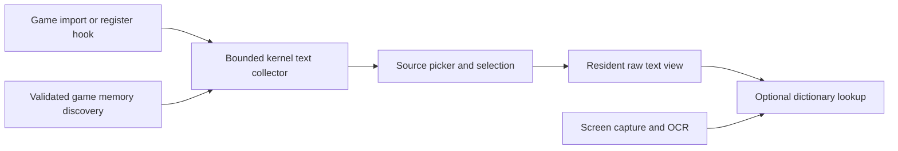

# Native text architecture and limits

The native backend supplies text to the existing dictionary overlay. It is not a port of LunaHook's Windows injector or emulator JIT machinery. Native Vita code is ARM/Thumb; PSP/Adrenaline is a separate MIPS/Allegrex problem.

## Responsibilities

| Component | Responsibility | Key boundary |
|---|---|---|
| `text/main.c` game plugin | Observe imported calls and optional signed register sites, submit bounded text observations | A loaded module can install zero useful hooks. Inspect attachment results. |
| `kernel/text.c` | Process-scoped mapping, bounded discovery, decoding, source ranking and snapshots | Shell cannot safely dereference an arbitrary game pointer. Validate allocation identity and mapping lifetime. |
| `shell/worker.c` | Activation, source selection, debounce, view publication and optional lookup | Raw text and picker must survive failure to allocate dictionary result arenas. |
| `shell/overlay.cpp` and strip | Display selected text and dictionary UI | Rendered controls are not evidence that game capture succeeded. |
| `core/text_*`, `core/utf.c` | Portable decoding, matching and source policy | Host tests exercise policy; platform bindings need separate validation. |

## Configured source modes

- `text_source = hooks`: manual picker without an OCR request.
- `text_source = auto`: OCR can provide an initial matching anchor, then a selected native source supplies text.
- `text_source = ocr`: existing OCR path.

A unique normalized OCR match of at least 80% can select a source; equal best candidates still need manual selection. Whitespace and punctuation are ignored and fullwidth ASCII folded for matching. Four normalized characters are required. These policies do not prove that a source is the current visible page.

## Fixed bounds

| Item | Bound or behavior |
|---|---|
| Retained sources | 24 |
| Displayed picker candidates | 5 |
| Text per source | 1,024 UTF-8 output bytes; 256 decoded codepoints |
| Discovery per worker tick | Up to four 4 KiB pages or 64 hole probes |
| Selected source | Stops full discovery scan; revalidation remains necessary |
| Busy collector | Drops observation instead of blocking the game thread |
| Existing scan scratch | 5,122 B, reused under text mutex |
| Lookup debounce | 300 ms after text changes |

CP932 conversion is generated reproducibly from Python's codec. Generic string/copy hooks accept UTF-8/CP932 paths; memory scanning and profiles also cover UTF-16 where configured. Scanner candidates need NUL termination and Japanese-content filtering. This may miss command-interleaved strings, fragmented text, custom glyph IDs or pointers into longer script buffers.

## Source identity matters

A **hook** observes a call site. A **pointer** follows a changing string pointer. A **buffer** rereads one address. A static script buffer may contain the page but never advance with the game. Source selection is scoped to the foreground process session; game switch, suspend/resume or invalid allocation identity must invalidate it.

Signed native profiles require actual module NID, segment offset, ARM/Thumb mode and instruction bytes for the exact game revision. Emulator guest addresses alone are insufficient. Profiles support at most eight sites, registers r0–r12/SP/LR, 0–4 dereferences and UTF-8/UTF-16LE/CP932 encodings. Hooks inside unsupported instruction sequences or Thumb IT blocks require separate analysis.

## Why generic does not mean universal

Font calls may occur only while building a glyph cache. Draw calls expose textured geometry, not necessarily character codes. A game may use its own font table, custom encoding, or an engine-specific decoder. A generic backend can still discover useful sources, but visible-current-page behavior must be measured. [[07-CLANNAD-investigation]] is the first commercial-title investigation, not a coverage benchmark.

Related: [[05-Kernel-syscall-stack]], [[06-Low-memory-overlay]], [[08-Validation-and-measurements]], [[11-Sources-and-artifacts]].
